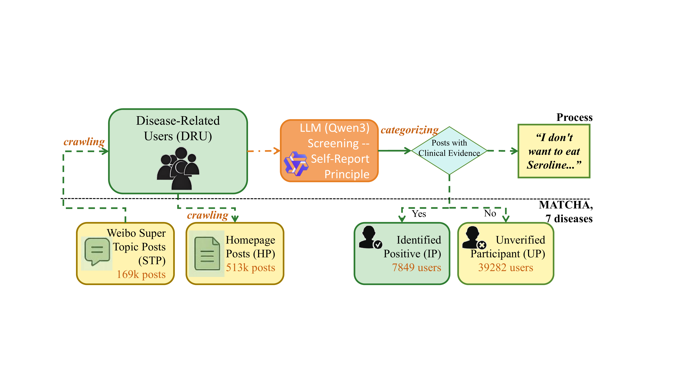

# MATCHA: A Chinese Multi-Disorder Mental Health Dataset with Cross-Lingual Analyses on Social Media

**Published in Findings of EMNLP 2026**

[**Paper**](https://aclanthology.org/2026.findings-emnlp.2267/) | [**PDF**](https://aclanthology.org/2026.findings-emnlp.2267.pdf) | [**Hugging Face**](https://huggingface.co/datasets/emiliememe/MATCHA/) | [**ModelScope**](https://www.modelscope.cn/datasets/BaihanLi12/MATCHA_Multi-Disorder_mental_health_daTa_in_CHinA/)

## Introduction

MATCHA (Multi-disorder mental heAlth daTa in CHinA) is a large-scale Chinese multi-disorder mental health dataset collected from Weibo, covering seven DSM-5 disorders and a control group.

The dataset comprises **46,025 cohort-level users and 1,834,699 within-cohort unique posts**, linking disorder-specific Super-Topic Posts (STP) with users' broader public Homepage Posts (HP).

MATCHA supports community-aware mental health NLP research, cross-disorder analyses, cue-reduced cohort classification, and descriptive cross-lingual comparisons with Twitter-STMHD.

## Key Features

- **Community-Driven Collection:** Leverages Weibo Super-Topics as organic contexts for mental health discourse.
- **Dual-Source Design:** Links Super-Topic Posts (STP) with Homepage Posts (HP), enabling analysis both within and beyond disorder-centered communities.
- **LLM-Assisted Stratification:** Uses Qwen3 to identify users with explicit Clinical Evidence Posts (CEP). Identified Positive (IP) labels represent textual evidence of self-disclosure, not clinically verified diagnoses.
- **Cross-Lingual Analysis:** Supports descriptive comparisons of linguistic, behavioral, symptom-related, and life-event-related patterns between Weibo and Twitter-STMHD.

## Get Access

To ensure the ethical use of sensitive mental health data, MATCHA is available under a **controlled-access system** for academic and non-commercial research purposes.

### Access Requirements

- **Academic Identity:** Applicants must be affiliated with a university or a recognized research institution.
- **Non-Commercial Commitment:** Users must agree to use the data exclusively for non-profit research.
- **Privacy Compliance:** Users must commit to de-identification protocols and are strictly prohibited from attempting to re-identify any individuals.

## 🟢 How to Get Access

To protect the privacy of mental health subjects, we follow a strict **Dual-Verification** process:

### Step 1: Download & Sign DUA

Download the [DUA.md](./DUA.md) (or PDF version), fill in your information, and sign it.

### Step 2: Email the Application

Send an email to **baihan.li612@gmail.com** with the following:

- **Subject:** [MATCHA Access Request] Your Name - Your Institution
- **Attachment:** The signed DUA file.
- **Content:** Provide the **Email Address** you use for ModelScope/Hugging Face.

### Step 3: Platform Request

Submit an access request on your preferred platform using the **SAME email address** as your signed DUA:

- [ModelScope Request Link](https://www.modelscope.cn/datasets/BaihanLi12/MATCHA_Multi-Disorder_mental_health_daTa_in_CHinA/)
- [Hugging Face Request Link](https://huggingface.co/datasets/emiliememe/MATCHA/)

## Overview of MATCHA

<p align="center">
  
  <br>
  <em>Figure 1: Overview of the MATCHA Dataset Collection and Annotation Pipeline.</em>
</p>

**Symptom Distribution:** MATCHA shows elevated negative affect and symptom-related signals in disorder-centered Super-Topic discussions.

**Life Events:** Super-Topic Posts exhibit higher life-event proxy-signal densities than Homepage Posts across all seven disorders.

**Cross-Lingual Comparison:** Platform- and language-associated variation between Weibo and Twitter-STMHD often exceeds cross-disorder variation across measured dimensions.

## Citation

If you use MATCHA in your research, please cite our paper:

```bibtex
@inproceedings{jin-etal-2026-matcha,
    title = "{MATCHA}: A {C}hinese Multi-Disorder Mental Health Dataset with Cross-Lingual Analyses on Social Media",
    author = "Jin, Bingrui and Li, Baihan and Li, Zitong and Li, Shimeng and Lan, Kunyao and Zhu, Kenny Q. and Wu, Mengyue",
    booktitle = "Findings of the Association for Computational Linguistics: EMNLP 2026",
    year = "2026",
    month = oct,
    address = "Budapest, Hungary",
    publisher = "Association for Computational Linguistics",
    url = "https://aclanthology.org/2026.findings-emnlp.2267/",
    pages = "48536--48553"
}
```

